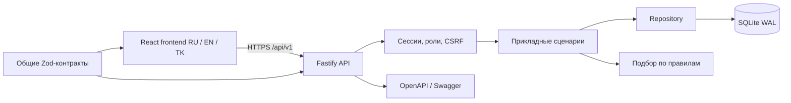
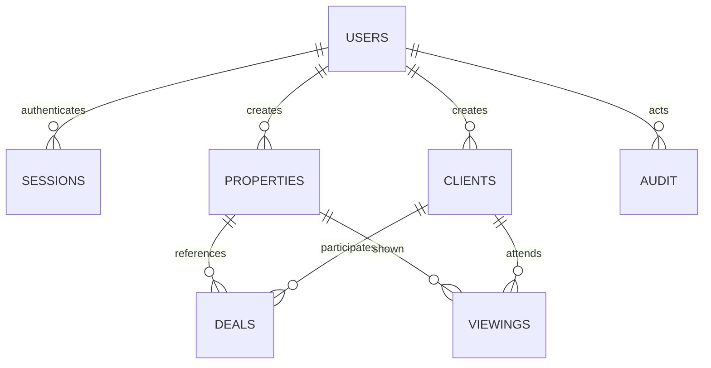

# Архитектура Mekan

## Границы компонентов

Frontend и backend — отдельные приложения с собственными package.json и TypeScript-конфигурациями. В development они запускаются отдельными процессами. В production React собирается в статические ресурсы, которые может обслуживать Fastify или внешний web server с проксированием `/api` на backend.

`modules/auth.ts` отвечает за учётные записи и сессии. `modules/crm.ts` обрабатывает прикладные сценарии и проверяет связи. `repository.ts` строит параметризованные запросы и преобразует денежные единицы. `database.ts` управляет подключением, транзакциями и версией схемы. `matching.ts` содержит независимый алгоритм без HTTP-зависимостей.

`packages/contracts` — единый источник допустимых полей, перечислений и типов. Backend валидирует входные данные независимо от frontend. OpenAPI и сериализаторы ответов используют те же схемы. React получает ошибки API в одном формате; текст ошибок переводится локально.

## Данные

- Рабочие сущности содержат `id`, `createdBy`, `createdAt`, `updatedAt`, `version`.
- Связи сделок и показов защищены внешними ключами; связанные объекты и клиенты нельзя удалить.
- Денежные поля — целые числа в сотых долях; API конвертирует значения при чтении и записи.
- SQLite WAL подходит для локального диплома и небольшого агентства с одним экземпляром backend. В проекте не заявляется распределённая запись несколькими экземплярами.
- Изменение рабочей записи и событие аудита выполняются в одной транзакции.
- Проверка пересечения показов и запись нового показа также выполняются в одной транзакции.

## Конкурентные изменения

PUT должен содержать текущий `version`. UPDATE выполняется с условием `WHERE id=? AND version=?`, затем увеличивает версию. При несовпадении API возвращает 409 `conflict`; интерфейс не перезаписывает чужие изменения молча. DELETE проверяет версию из `If-Match`.

## Сессии и доступ

Сессии выбраны вместо хранения JWT в localStorage: HttpOnly cookie не доступна JavaScript. В БД хранится SHA-256 случайного токена, срок действия ограничен. Для записи проверяются Origin и отдельный CSRF-токен. Переключение языка не влияет на данные и доступ.

Агент имеет доступ к общей рабочей базе агентства, но не может удалять записи, управлять сотрудниками или читать аудит. Администратор имеет эти полномочия. Отключение сотрудника отзывает его сессии; смена пароля отзывает старые сессии и создаёт новую для текущего пользователя.

## Миграции

Таблица `migrations` хранит номер, название и дату применения. Новые изменения схемы следует добавлять отдельными последовательными миграциями, не меняя уже применённую миграцию. При обновлении существующей БД резервная копия обязательна как эксплуатационная мера. Тест миграции проверяет перенос старых JSON-карточек, точность денежных значений и повторный запуск.

## Проверка и публикация

CI выполняет установку по lockfile, TypeScript, тесты, production build и аудит runtime-зависимостей. Конфигурация CI добавлена в репозиторий; наличие файла не означает, что workflow уже запускался на GitHub.

Реальная эксплуатация дополнительно требует HTTPS, резервного копирования, контроля ресурсов сервера, мониторинга логов и ручного браузерного приёмочного тестирования. Автоматические тесты в репозитории не доказывают готовность к произвольной производственной нагрузке.

Официальные справочники используемых интеграций: [Fastify TypeScript](https://fastify.dev/docs/latest/Reference/TypeScript/), [Swagger UI](https://github.com/fastify/fastify-swagger-ui), [static serving](https://github.com/fastify/fastify-static).
